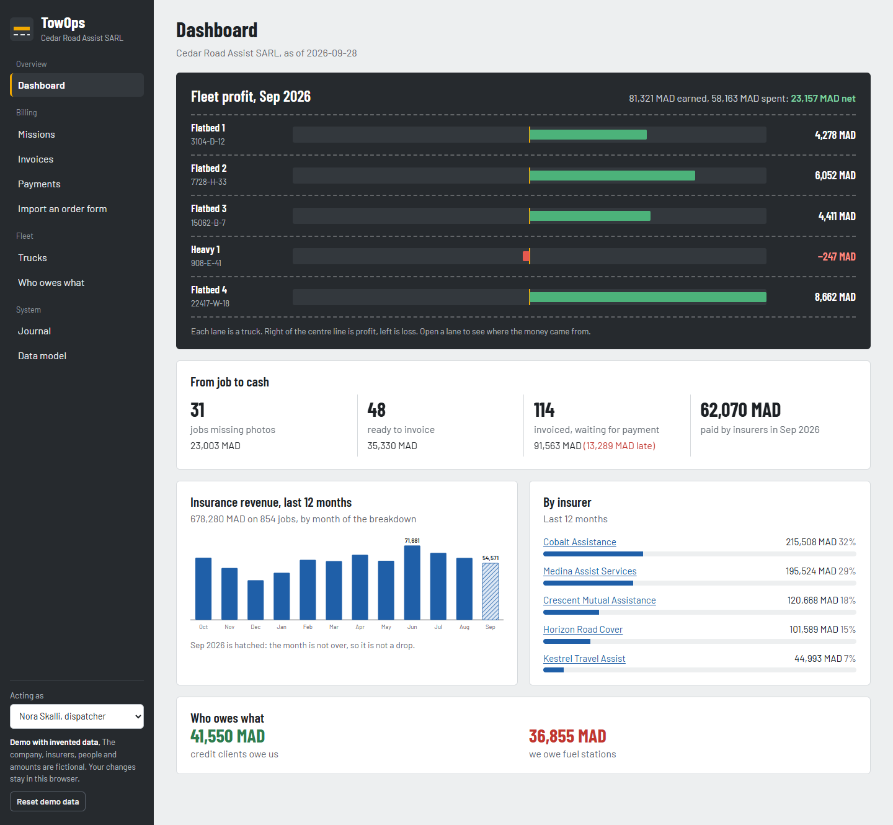
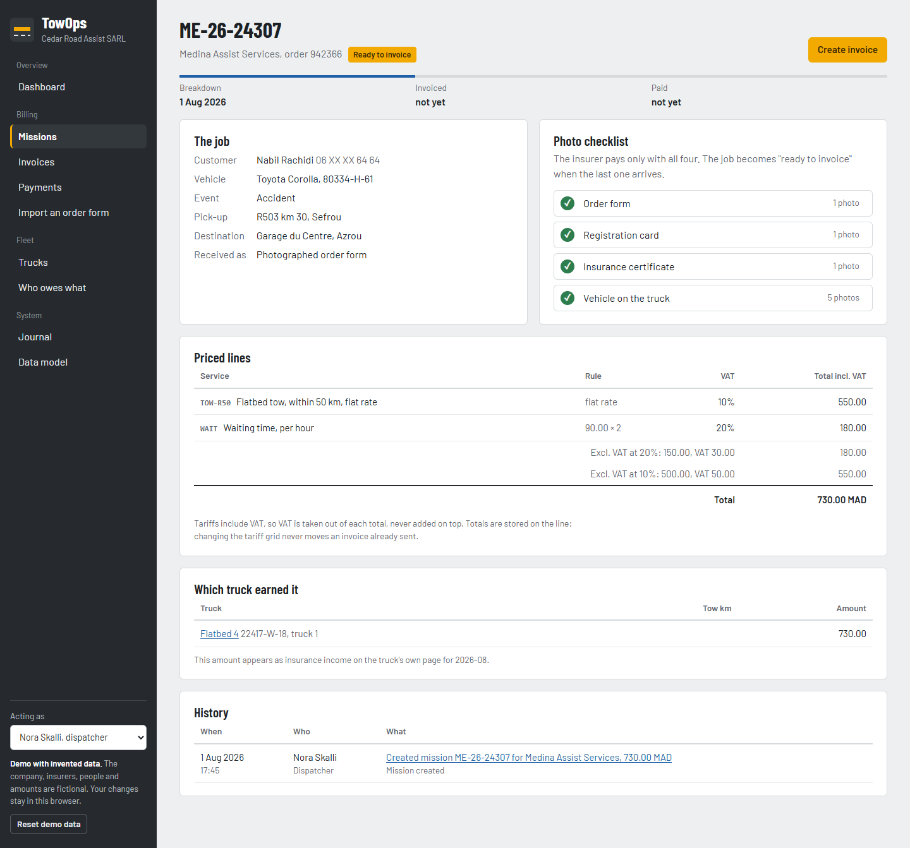
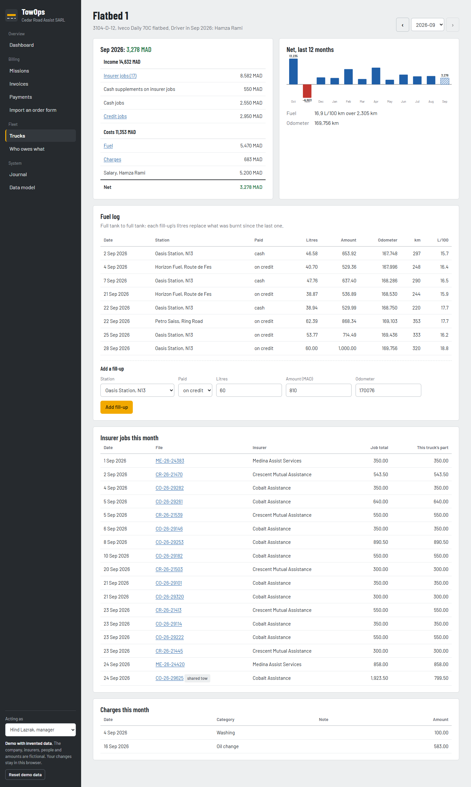
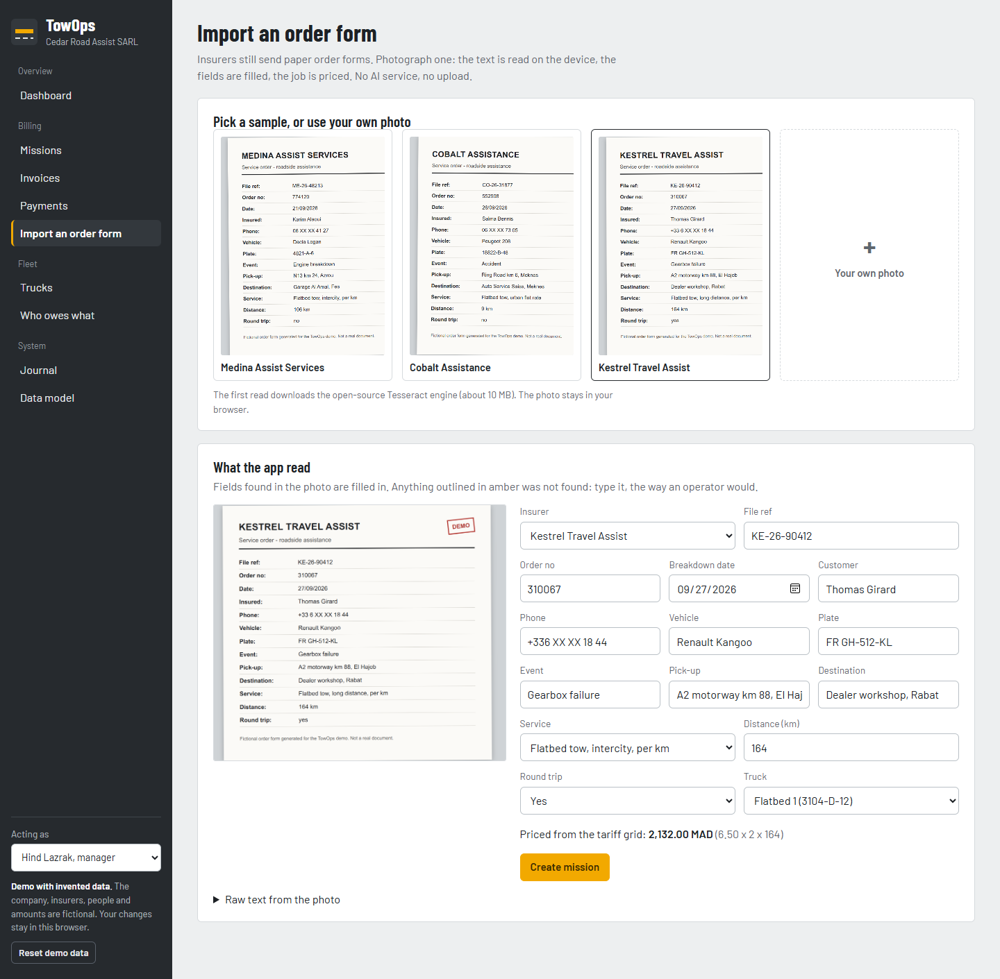
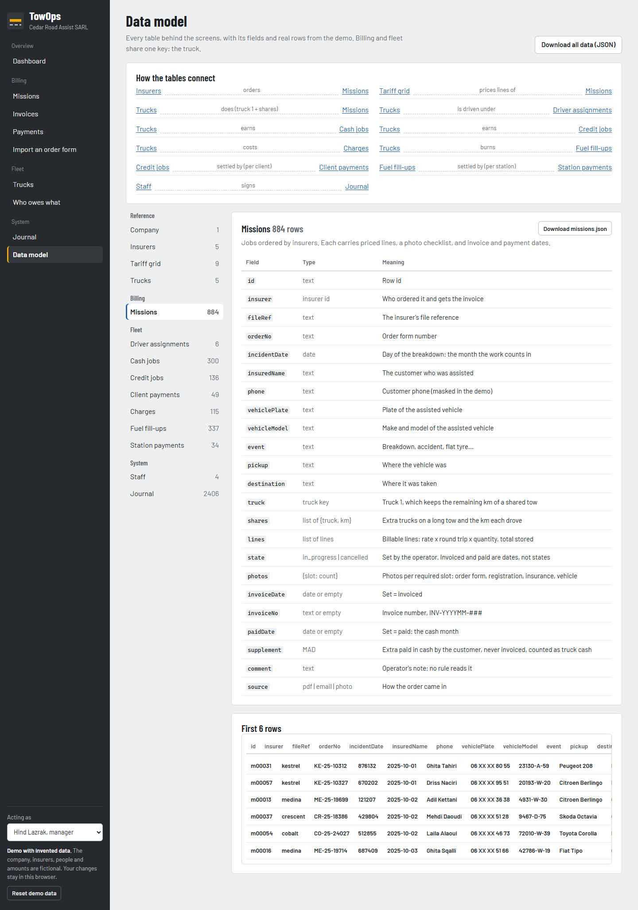
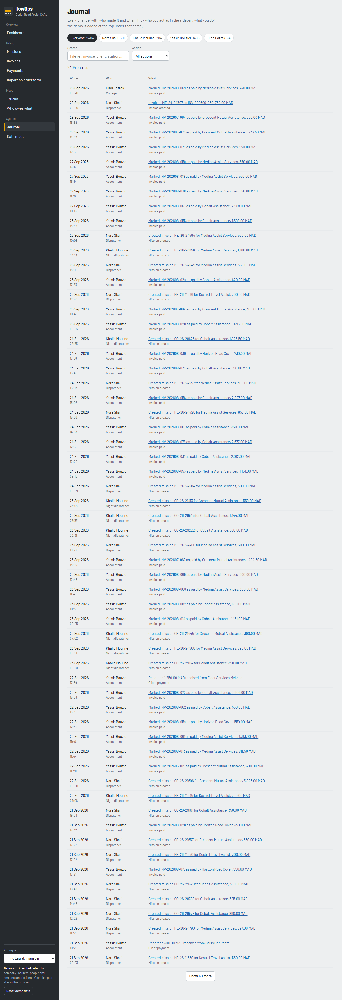
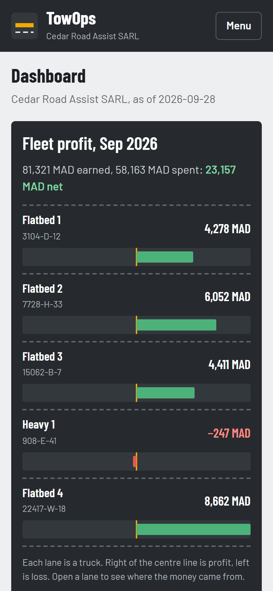

# TowOps

**From the insurer's order to cash in the bank, and what each truck really earns.**
A working demo of the back office of a roadside-assistance and towing fleet.

Everything you see here runs on **invented data**: the company, insurers, customers, plates and amounts are fictional.



## The problem it solves

A towing company working for insurance assistance companies loses money in the gaps, not on the road:

- a job is done but **cannot be invoiced** because a photo of the registration card is missing;
- an invoice is sent but **nobody notices** the insurer is 40 days later than usual;
- a long tow is relayed by two trucks and **nobody knows which truck earned what**;
- a truck looks busy but **loses money** once fuel, repairs and the driver's salary are counted;
- fuel taken on credit piles up into **a debt to the station** that no one tracks.

TowOps puts each of those gaps on a screen.

## A tour of the screens

| Screen | What it answers |
|---|---|
| **Dashboard** | Which trucks made or lost money this month (each truck is a lane: right of the centre line is profit, left is loss). Where the money is stuck: missing photos, not invoiced yet, waiting for payment, late. |
| **Missions** | Every job ordered by an insurer, filterable by status, insurer, month and free text. |
| **Mission** | The priced lines with their rule visible (`6.50 x 2 x 164 km`), VAT taken out of VAT-included tariffs, the photo checklist, the split between trucks on a shared tow. One click creates the invoice, one click downloads it as a PDF, one click marks it paid. |
| **Invoices** | Jobs ready to invoice (invoice them all at once), invoices waiting for payment with their age against each insurer's usual delay, a month-by-month summary, and the register of every invoice ever issued: search by number, insurer, month or payment, PDF on each row. |
| **Payments** | Every payment that settles a debt, month by month: insurers paying invoices and credit clients paying (money in), fuel stations being paid (money out). Read from the invoices and accounts themselves, never typed twice. |
| **Trucks** | Per truck and per month: insurer jobs + cash + credit income, minus fuel, charges and salary. 12-month profit chart, fuel log with L/100 km, a wrong odometer reading flagged. |
| **Import an order form** | Photograph a paper order form: the text is read **on the device** (open-source OCR, no AI service, no upload), the fields are filled, the job is priced from the tariff grid. |
| **Who owes what** | Credit clients' balances and fuel-station debts, taken minus paid. |
| **Journal** | Every change, who made it and when: 12 months of history from four invented staff (dispatchers, accountant, manager). Pick who you act as in the sidebar and your own changes are signed with that name. Each mission also shows its own history. |
| **Data model** | Every table, its fields in plain language, and its first rows. Download the whole dataset as JSON. |

| | |
|---|---|
|  |  |
|  |  |

Every change is signed by the person who made it:



It works on a phone as well as on a desk:



## The data model

Two sides of one business, joined by one key, the truck's normalised plate:

```
Insurers ──orders──> Missions <──priced by── Tariff grid
                        │
                  truck (+ shares)
                        │
                        v
Trucks ──> driver assignments, cash jobs, credit jobs, charges, fuel fill-ups
                                          │                    │
                               client payments       station payments

Staff ──signs──> Journal (every change, written by the app itself)
```

Truck profit reads its insurance income **from the missions**, so billing and fleet can never disagree. The full model, with every field and an example row per table, is in **[docs/data-model.md](docs/data-model.md)**, and the raw data is in [`data/`](data/).

## How it is built

| Part | Choice | Why |
|---|---|---|
| App | TypeScript, no framework, Vite | Small, fast on cheap phones, nothing to upgrade every six months |
| Business rules | Pure functions in [`src/logic/`](src/logic/) | Tested without a browser; the screens never add anything up themselves |
| Charts | Hand-written SVG | No chart library in the bundle |
| Invoices | jsPDF, loaded on first click | The PDF code never slows the first page |
| OCR | Tesseract.js, loaded on first read | Runs in the browser: the photo never leaves the device |
| Demo data | A seeded generator ([`scripts/generate-data.ts`](scripts/generate-data.ts)) | Same data on every run, regenerate it to check |
| Storage in the demo | The visitor's own browser | Try anything; "Reset demo data" restores the original |

A production deployment adds what a real company needs and a demo does not: a Cloudflare Worker API with a SQLite (D1) database, offline-first sync between phone and PC, real logins with roles (the demo's "Acting as" picker stands in for them), the journal kept on the server where nobody can edit it, and a password gate.

## Run it

Requires [Node.js](https://nodejs.org) 20 or later.

```bash
npm install
npm run dev        # http://localhost:5190
```

Build a static copy that can be hosted anywhere (`dist/`):

```bash
npm run build
npm run preview    # http://localhost:4173
```

## Tests

```bash
npm run typecheck
npm test           # 19 unit tests: pricing, VAT, truck split, fuel, debts, payments, journal, OCR parsing, data consistency
npm run build && npm run smoke   # 41 end-to-end checks in Microsoft Edge, including real OCR on the samples
```

The smoke test also refreshes the screenshots in `docs/screenshots/`.

Regenerate the demo data, the order-form images and the data-model document:

```bash
npm run data && npm run samples && npm run docs:model
```

## Contact

Built by Zouhair Lahlou.

- Email: [zouhurlahlou@gmail.com](mailto:zouhurlahlou@gmail.com)
- WhatsApp: [+212 605 315 354](https://wa.me/212605315354)
