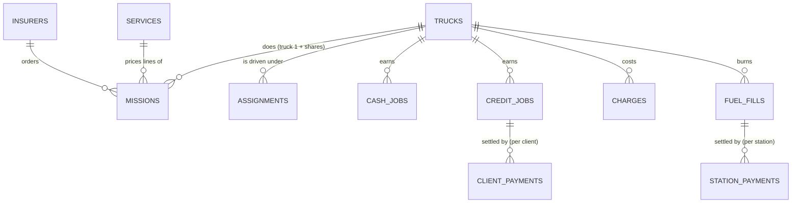

# Data model

Generated by `npm run docs:model` from `src/model/schema.ts`. Do not edit by hand.

TowOps keeps two sides of one business in one dataset, joined by the **truck key** (the normalised plate):

- **Billing**: insurers order missions, each mission carries priced lines, gets an invoice date, then a payment date.
- **Fleet**: what each truck earns and costs per month. Its insurance income is *read from the missions*, never typed twice.

Conventions: dates are `YYYY-MM-DD`, months `YYYY-MM`, amounts are MAD (Moroccan dirham) with VAT included.

## How the tables connect



## Rules that hold the model together

1. **One fact per status.** A mission is *invoiced* when it has an `invoiceDate`, *paid* when it has a `paidDate`, *ready* when every photo slot has a photo. No status column can drift out of step with those facts.
2. **Line totals are stored.** `rate x roundTrip x quantity` is computed once and saved, so editing the tariff grid never changes an invoice already sent.
3. **VAT comes out of the price, not on top.** Tariffs are VAT-included; each rate's excl. amount is `incl / (1 + rate)`. Foreign insurers are invoiced at 0 %.
4. **A shared tow splits by kilometres.** Extra trucks get the per-km tow line in proportion to the km they drove; truck 1 keeps the rest, so the parts always add up to the mission total.
5. **Fuel is measured full tank to full tank.** L/100 km = litres / (odometer - previous odometer) x 100. A reading that goes backwards is flagged and skipped.
6. **Debts are taken minus paid, per name**, with names matched ignoring case and spacing.

## Tables

### Company `data/company.json`

The operator itself, printed at the top of every invoice. One record. 1 row in the demo.

| Field | Type | Meaning |
|---|---|---|
| `name` | text | Legal name |
| `tagline` | text | One line under the name on invoices |
| `address` | text | Street address |
| `city` | text | City |
| `phone` | text | Dispatch phone |
| `email` | text | Billing email |
| `taxId` | text | Tax identifier (fake in the demo) |
| `bank` | text | Bank for transfers (fake in the demo) |

<details><summary>Example row</summary>

```json
{
  "name": "Cedar Road Assist SARL",
  "tagline": "Roadside assistance and towing, 24/7",
  "address": "14 Rue des Orangers, Zone Industrielle",
  "city": "Meknes, Morocco",
  "phone": "+212 5XX XX XX XX",
  "email": "dispatch@cedarroad.example",
  "taxId": "ICE DEMO-000000000",
  "bank": "Demo Bank (no real account in the demo)"
}
```

</details>

### Insurers `data/insurers.json`

Assistance companies that order missions and receive invoices. 5 rows in the demo.

| Field | Type | Meaning |
|---|---|---|
| `id` | text | Short identifier |
| `name` | text | Name printed on the invoice |
| `address` | text | Billing address |
| `taxId` | text | Their tax identifier (fake) |
| `vatExempt` | yes/no | Foreign insurer: invoiced without VAT |
| `paysAfterDays` | number | Usual payment delay, in days |

<details><summary>Example row</summary>

```json
{
  "id": "cobalt",
  "name": "Cobalt Assistance",
  "address": "120 Boulevard Anfa, Casablanca",
  "taxId": "DEMO-TAX-0101",
  "vatExempt": false,
  "paysAfterDays": 45
}
```

</details>

### Tariff grid `data/services.json`

Every service that can be billed, with its price rule and VAT rate. 9 rows in the demo.

| Field | Type | Meaning |
|---|---|---|
| `code` | text | Short code, the link from a mission line |
| `label` | text | Description printed on the invoice |
| `mode` | flat \| km \| quantity \| price | How the line is priced |
| `rate` | MAD or empty | VAT-included rate; empty when typed per mission |
| `vat` | 0 \| 10 \| 20 | VAT rate in percent |
| `towing` | yes/no | Done by a flatbed: per-km towing lines can be split between trucks |
| `expense` | yes/no | Pass-through cost re-invoiced at cost (tolls) |

<details><summary>Example row</summary>

```json
{
  "code": "TOW-URB",
  "label": "Flatbed tow, urban flat rate",
  "mode": "flat",
  "rate": 300,
  "vat": 10,
  "towing": true,
  "expense": false
}
```

</details>

### Trucks `data/trucks.json`

The fleet. The normalised plate is the key that links billing to fleet. 5 rows in the demo.

| Field | Type | Meaning |
|---|---|---|
| `key` | text | Normalised plate, the join key |
| `plate` | text | Plate as written |
| `model` | text | Make and body |
| `name` | text | Short name used by the team |

<details><summary>Example row</summary>

```json
{
  "key": "3104d12",
  "plate": "3104-D-12",
  "model": "Iveco Daily 70C flatbed",
  "name": "Flatbed 1"
}
```

</details>

### Driver assignments `data/assignments.json`

Who drives which truck, at what salary, from which month. A change adds a row; past months keep the old one. 6 rows in the demo.

| Field | Type | Meaning |
|---|---|---|
| `id` | text | Row id |
| `truck` | truck key | The truck |
| `driver` | text | Driver name |
| `salary` | MAD / month | Monthly salary, counted as a truck cost |
| `from` | month | First month this assignment applies |

<details><summary>Example row</summary>

```json
{
  "id": "as00001",
  "truck": "3104d12",
  "driver": "Hamza Rami",
  "salary": 5200,
  "from": "2025-10"
}
```

</details>

### Missions `data/missions.json`

Jobs ordered by insurers. Each carries priced lines, a photo checklist, and invoice and payment dates. 884 rows in the demo.

| Field | Type | Meaning |
|---|---|---|
| `id` | text | Row id |
| `insurer` | insurer id | Who ordered it and gets the invoice |
| `fileRef` | text | The insurer's file reference |
| `orderNo` | text | Order form number |
| `incidentDate` | date | Day of the breakdown: the month the work counts in |
| `insuredName` | text | The customer who was assisted |
| `phone` | text | Customer phone (masked in the demo) |
| `vehiclePlate` | text | Plate of the assisted vehicle |
| `vehicleModel` | text | Make and model of the assisted vehicle |
| `event` | text | Breakdown, accident, flat tyre... |
| `pickup` | text | Where the vehicle was |
| `destination` | text | Where it was taken |
| `truck` | truck key | Truck 1, which keeps the remaining km of a shared tow |
| `shares` | list of {truck, km} | Extra trucks on a long tow and the km each drove |
| `lines` | list of lines | Billable lines: rate x round trip x quantity, total stored |
| `state` | in_progress \| cancelled | Set by the operator. Invoiced and paid are dates, not states |
| `photos` | {slot: count} | Photos per required slot: order form, registration, insurance, vehicle |
| `invoiceDate` | date or empty | Set = invoiced |
| `invoiceNo` | text or empty | Invoice number, INV-YYYYMM-### |
| `paidDate` | date or empty | Set = paid: the cash month |
| `supplement` | MAD | Extra paid in cash by the customer, never invoiced, counted as truck cash |
| `comment` | text | Operator's note; no rule reads it |
| `source` | pdf \| email \| photo | How the order came in |

<details><summary>Example row</summary>

```json
{
  "id": "m00031",
  "insurer": "kestrel",
  "fileRef": "KE-25-10312",
  "orderNo": "876132",
  "incidentDate": "2025-10-01",
  "insuredName": "Ghita Tahiri",
  "phone": "06 XX XX 80 55",
  "vehiclePlate": "23130-A-59",
  "vehicleModel": "Peugeot 208",
  "event": "Flat tyre",
  "pickup": "N13 km 68, Ifrane",
  "destination": "Customer's home, Fes",
  "truck": "7728h33",
  "shares": [],
  "lines": [
    {
      "serviceCode": "TOW-R50",
      "label": "Flatbed tow, within 50 km, flat rate",
      "rate": 550,
      "roundTrip": 1,
      "quantity": 1,
      "total": 550,
      "vat": 10
    }
  ],
  "state": "in_progress",
  "photos": {
    "orderForm": 1,
    "registration": 1,
    "insurance": 1,
    "vehicle": 5
  },
  "invoiceDate": "2025-11-05",
  "invoiceNo": "INV-202511-001",
  "paidDate": "2025-12-03",
  "supplement": 0,
  "comment": "Keys left with the garage.",
  "source": "photo"
}
```

</details>

### Cash jobs `data/cashJobs.json`

Private jobs paid in cash on the spot. 300 rows in the demo.

| Field | Type | Meaning |
|---|---|---|
| `id` | text | Row id |
| `truck` | truck key | The truck |
| `date` | date | Day of the job |
| `amount` | MAD | Cash received |
| `note` | text | Free note |

<details><summary>Example row</summary>

```json
{
  "id": "cj00909",
  "truck": "7728h33",
  "date": "2025-10-01",
  "amount": 200,
  "note": ""
}
```

</details>

### Credit jobs `data/creditJobs.json`

Jobs for business clients who pay later. 136 rows in the demo.

| Field | Type | Meaning |
|---|---|---|
| `id` | text | Row id |
| `truck` | truck key | The truck |
| `date` | date | Day of the job |
| `client` | text | Client who owes the amount |
| `amount` | MAD | Amount owed |
| `note` | text | Free note |

<details><summary>Example row</summary>

```json
{
  "id": "cr00896",
  "truck": "3104d12",
  "date": "2025-10-01",
  "client": "Saiss Car Rental",
  "amount": 1150,
  "note": ""
}
```

</details>

### Client payments `data/clientPayments.json`

Money received from credit clients. Linked to the client, not to a truck. 49 rows in the demo.

| Field | Type | Meaning |
|---|---|---|
| `id` | text | Row id |
| `client` | text | Client who paid |
| `date` | date | Day received |
| `amount` | MAD | Amount received |

<details><summary>Example row</summary>

```json
{
  "id": "cp01816",
  "client": "Fleet Services Meknes",
  "date": "2025-11-19",
  "amount": 1950
}
```

</details>

### Charges `data/charges.json`

Truck costs other than fuel and salary. 115 rows in the demo.

| Field | Type | Meaning |
|---|---|---|
| `id` | text | Row id |
| `truck` | truck key | The truck |
| `date` | date | Day paid |
| `category` | text | Tyres, repair, oil change, washing... |
| `amount` | MAD | Amount paid |
| `note` | text | Free note |

<details><summary>Example row</summary>

```json
{
  "id": "ch00925",
  "truck": "7728h33",
  "date": "2025-10-01",
  "category": "Washing",
  "amount": 100,
  "note": ""
}
```

</details>

### Fuel fill-ups `data/fuelFills.json`

Every fill-up with litres and odometer. On credit, it adds to the debt owed to the station. 336 rows in the demo.

| Field | Type | Meaning |
|---|---|---|
| `id` | text | Row id |
| `truck` | truck key | The truck |
| `station` | text | Fuel station |
| `date` | date | Day of the fill-up |
| `payment` | credit \| cash | Credit = owed to the station |
| `amount` | MAD | Amount |
| `litres` | number | Litres pumped |
| `odometer` | km | Odometer reading: consumption is full tank to full tank |

<details><summary>Example row</summary>

```json
{
  "id": "f00918",
  "truck": "7728h33",
  "station": "Oasis Station, N13",
  "date": "2025-10-02",
  "payment": "credit",
  "amount": 772.41,
  "litres": 59.18,
  "odometer": 189294
}
```

</details>

### Station payments `data/stationPayments.json`

Payments that settle fuel taken on credit. 33 rows in the demo.

| Field | Type | Meaning |
|---|---|---|
| `id` | text | Row id |
| `station` | text | Station paid |
| `date` | date | Day paid |
| `amount` | MAD | Amount paid |

<details><summary>Example row</summary>

```json
{
  "id": "sp01827",
  "station": "Oasis Station, N13",
  "date": "2025-11-06",
  "amount": 6100
}
```

</details>
